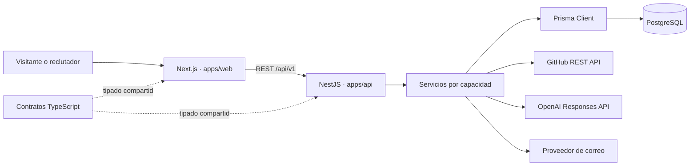
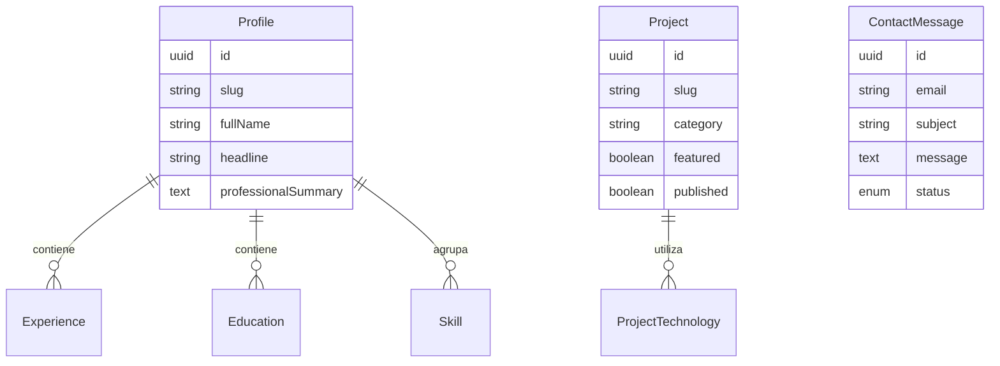

# Portafolio Full-Stack | Edwin Gustavo Rodríguez

> Portafolio profesional y hoja de vida digital construidos como un producto full-stack: interfaz accesible, API REST versionada, persistencia relacional, documentación OpenAPI, integraciones externas, pruebas automatizadas y despliegue con contenedores.


## Perfil técnico

Soy **Edwin Gustavo Rodríguez**, Ingeniero de Sistemas y Tecnólogo en Desarrollo de Software y Redes. Tengo más de 20 años de trayectoria en análisis de riesgos y protección de personas; hoy aplico ese criterio a la construcción de software de producción, con una mirada práctica sobre seguridad, continuidad operativa, trazabilidad y manejo responsable de información.

Como desarrollador autónomo he diseñado, construido y desplegado dos aplicaciones web para clientes externos: **EDS La Fortaleza**, para la gestión integral de una estación de servicio, y **Pautas JI**, para la administración comercial y audiovisual de James Informa. Son soluciones verificables en uso real que cubren análisis de requisitos, modelado relacional, backend, interfaz, autenticación, persistencia, despliegue y mantenimiento.

En estas implementaciones he trabajado con arquitecturas monolíticas Node.js/Express, PostgreSQL y MySQL, Docker, PWA y Railway. Aplico controles verificables: sesiones persistentes, control de acceso por roles, consultas SQL parametrizadas, hash de contraseñas, cabeceras de seguridad, validación de archivos y auditoría de acciones. No se publican métricas de clientes que no estén autorizadas; las demos, capturas y repositorios públicos son la evidencia disponible.

## Qué resuelve este producto

El portafolio transforma una hoja de vida estática en una aplicación consultable y verificable. Permite que una persona reclutadora o un equipo técnico pueda:

- consultar perfil, trayectoria, educación, certificaciones y habilidades;
- explorar proyectos mediante fichas técnicas, tecnologías, capturas, demos y repositorios;
- abrir el detalle de cada proyecto mediante una ruta estable basada en `slug`;
- imprimir o descargar una hoja de vida independiente con diseño optimizado para PDF;
- enviar un mensaje desde un formulario validado y persistido antes de la notificación;
- consultar repositorios públicos de GitHub sin exponer credenciales en el navegador;
- utilizar un asistente profesional con IA que responde únicamente con contexto verificado del portafolio;
- navegar con tema claro/oscuro, controles de accesibilidad, teclado y movimiento reducido.

## Proyectos que demuestran experiencia aplicada

| Producto                                    | Problema abordado                                                                                                         | Aporte full-stack                                                                                          | Tecnologías principales                                        | Evidencia                                                                                                                           |
| ------------------------------------------- | ------------------------------------------------------------------------------------------------------------------------- | ---------------------------------------------------------------------------------------------------------- | -------------------------------------------------------------- | ----------------------------------------------------------------------------------------------------------------------------------- |
| **Pautas JI**                               | Administración de clientes, planes de pauta, actividad comercial, contenido audiovisual, recaudo e informes mensuales.    | Plataforma PWA para cliente externo, con sesión persistente, roles, auditoría y dashboard con indicadores. | Node.js 22, Express 5, PostgreSQL, Chart.js, Docker, Railway   | [Aplicación](https://pautas-ji-web-production.up.railway.app/)                                                                      |
| **Taxi Ji**                                 | Control de vehículos, conductores, producción, gastos, mantenimiento, documentos y rentabilidad de una flota.             | Modelado operativo y financiero, interfaz de seguimiento, API y persistencia relacional.                   | React, NestJS, PostgreSQL, Prisma                              | [Código](https://github.com/edwguro/taxi-ji)                                                                                        |
| **Territorio 360**                          | Lectura de patrones, escenarios, actores y puntos críticos para apoyar decisiones territoriales.                          | Experiencia geoespacial, navegación institucional y visualización analítica sobre mapas.                   | TypeScript, React, Node.js, PostgreSQL, Leaflet, OpenStreetMap | Demostración privada en el portafolio                                                                                               |
| **Gestión administrativa EDS Combustibles** | Centralización de ventas, rentabilidad, caja, cartera, inventario, personal y operación de una estación de servicio.      | Dashboard gerencial, reglas operativas, reportes y despliegue de una solución usada en un contexto real.   | JavaScript, Node.js, Express, EJS, MySQL, Railway              | [Repositorio](https://github.com/edwguro/EDS-LA-FORTALEZA) · [Aplicación](https://eds-la-fortaleza-production-9a15.up.railway.app/) |
| **Edufree API**                             | Administración académica mediante servicios REST y persistencia documental.                                               | Diseño de modelos, controladores, repositorios, autenticación y documentación de endpoints.                | TypeScript, LoopBack 4, MongoDB, Docker, OpenAPI               | [Código](https://github.com/edwguro/BackendEdufree-G28-E2)                                                                          |
| **Ganadería App**                           | Gestión administrativa y sanitaria de ejemplares: historias clínicas, razas, pesos, vacunas, reproducción y trazabilidad. | Modelado de dominio, flujos de ganaderos/veterinarios y seguimiento del ciclo productivo.                  | C#, .NET Core, HTML, CSS                                       | [Código](https://github.com/edwguro/EquipoColaborativo4)                                                                            |

Estos proyectos cubren distintos dominios —transporte, territorio, combustibles, educación y ganadería— y muestran capacidad para convertir reglas de negocio en productos de software mantenibles.

## Arquitectura de software

El sistema utiliza un **monolito modular dentro de un monorepo**. Esta decisión reduce complejidad operativa para el tamaño actual del producto, mantiene límites claros entre presentación, aplicación, datos e integraciones, y permite separar servicios más adelante si el dominio o la escala lo justifican.

Esta arquitectura corresponde al **portafolio/HV EGR**. Los sistemas EDS La Fortaleza y Pautas JI se documentan como experiencias de producto separadas: ambos usan un monolito Node.js/Express y base de datos relacional, pero sus fuentes, credenciales y datos operativos no forman parte de este repositorio.



### Responsabilidades por capa

| Capa                 | Responsabilidad                                                                                                           |
| -------------------- | ------------------------------------------------------------------------------------------------------------------------- |
| `apps/web`           | Renderizado con Next.js, composición de secciones, navegación, accesibilidad, formularios, tema y experiencia responsive. |
| `apps/api`           | API REST versionada, validación de entradas, orquestación de casos de uso, reglas de seguridad e integraciones externas.  |
| `packages/contracts` | Contratos TypeScript compartidos entre frontend y backend para evitar divergencias en respuestas públicas.                |
| `packages/ui`        | Componentes reutilizables desacoplados de las reglas de negocio.                                                          |
| `prisma`             | Esquema relacional, migraciones, semilla de datos y sincronización del contenido profesional.                             |
| PostgreSQL           | Fuente de verdad para perfil, experiencia, educación, proyectos, habilidades y mensajes de contacto.                      |

### Decisiones técnicas relevantes

- **Contratos primero:** el frontend consume interfaces compartidas; la API no expone entidades ORM como contrato público.
- **Controladores pequeños:** los controladores reciben y validan la petición; los servicios resuelven cada caso de uso.
- **Server-first:** Next.js obtiene información desde la API en el servidor y limita el JavaScript cliente a interacción necesaria.
- **Contenido trazable:** la hoja de vida se mantiene en `prisma/data/resume.ts` y se sincroniza de forma explícita con PostgreSQL.
- **Integraciones aisladas:** GitHub, OpenAI y correo se ejecutan en el backend; sus secretos nunca llegan al navegador.
- **Fallo controlado:** el frontend muestra estados seguros cuando un servicio no está disponible y la API publica errores sin trazas internas.
- **Persistencia antes de notificación:** el contacto se guarda en la base de datos antes de intentar enviar el correo.
- **IA con contexto limitado:** el asistente construye su contexto desde el perfil y los proyectos publicados y rechaza responder con información no disponible.

## Casos de uso principales

### 1. Evaluación profesional

1. La persona visitante abre el portafolio.
2. Next.js solicita perfil, proyectos y habilidades en paralelo.
3. NestJS consulta PostgreSQL mediante Prisma.
4. La interfaz presenta evidencia técnica, enlaces, certificaciones y proyectos sin exponer información interna.

### 2. Exploración de un proyecto

1. El visitante selecciona un proyecto publicado.
2. La web navega a `/proyectos/[slug]`.
3. La API recupera descripción, categoría, tecnologías, capturas, demo y repositorio.
4. La vista de detalle permite contrastar el resumen profesional con evidencia ejecutable o código fuente.

### 3. Contacto profesional

1. El formulario valida nombre, correo, asunto y longitud del mensaje.
2. Un campo honeypot filtra automatizaciones básicas.
3. La API aplica límite de solicitudes y guarda el mensaje.
4. El proveedor configurado envía una notificación; si falla, el mensaje permanece registrado.

### 4. Asistente profesional

1. El usuario formula una pregunta sobre experiencia, habilidades o proyectos.
2. La API genera un contexto exclusivamente con datos publicados.
3. OpenAI procesa la consulta sin almacenar la respuesta (`store: false`).
4. Si la información no existe, el asistente indica la limitación y recomienda el canal de contacto.

## API REST

Base local: `http://localhost:4100/api/v1`
Documentación interactiva: `http://localhost:4100/docs`

| Método | Endpoint               | Función                                                                      |
| ------ | ---------------------- | ---------------------------------------------------------------------------- |
| `GET`  | `/health`              | Estado y marca de tiempo del servicio.                                       |
| `GET`  | `/profile`             | Perfil, experiencia y educación ordenadas.                                   |
| `GET`  | `/projects`            | Proyectos publicados; admite filtros por categoría y tecnología.             |
| `GET`  | `/projects/:slug`      | Detalle técnico y evidencia de un proyecto.                                  |
| `GET`  | `/skills`              | Habilidades agrupadas por frontend, backend, datos, DevOps, API, redes e IA. |
| `GET`  | `/github/repositories` | Repositorios públicos propios, sin forks, con caché de diez minutos.         |
| `POST` | `/contact`             | Valida, persiste y notifica un mensaje profesional.                          |
| `POST` | `/ai/chat`             | Consulta al asistente con contexto profesional controlado.                   |

## Modelo de datos



## Stack tecnológico

| Área          | Tecnologías y prácticas                                                                                                              |
| ------------- | ------------------------------------------------------------------------------------------------------------------------------------ |
| Lenguaje      | TypeScript estricto, JavaScript moderno                                                                                              |
| Frontend      | Next.js, React, App Router, Server Components, Tailwind CSS, Radix Slot, Lucide, Motion                                              |
| Backend       | Node.js, NestJS, API REST, DTOs, class-validator, OpenAPI/Swagger                                                                    |
| Datos         | PostgreSQL 17, Prisma ORM, migraciones, semilla reproducible                                                                         |
| Seguridad     | Helmet/CSP, CORS por allowlist, límite de cuerpo, throttling global y específico, whitelist de DTOs, honeypot y secretos por entorno |
| Integraciones | GitHub REST API, OpenAI Responses API, Resend o proveedor de correo intercambiable                                                   |
| Calidad       | ESLint, Prettier, TypeScript, Jest, Playwright, Husky, lint-staged                                                                   |
| Plataforma    | pnpm workspaces, Turborepo, Docker Compose, Dockerfiles multi-stage, GitHub Actions                                                  |

## Estructura del repositorio

```text
.
├── apps/
│   ├── web/                 # Next.js: portafolio, detalle y HV imprimible
│   └── api/                 # NestJS: dominio, persistencia e integraciones
├── packages/
│   ├── contracts/           # Tipos de las respuestas públicas
│   ├── eslint-config/       # Reglas compartidas de calidad
│   ├── typescript-config/   # Configuración TypeScript estricta
│   └── ui/                  # Componentes reutilizables
├── prisma/
│   ├── data/resume.ts       # Fuente editable de la hoja de vida
│   ├── migrations/          # Evolución versionada del esquema
│   ├── schema.prisma        # Modelo de datos
│   └── seed.ts              # Datos profesionales y proyectos demostrables
├── e2e/                     # Pruebas de navegación y flujos críticos
├── docs/                    # Arquitectura y guía operativa
├── compose.yaml             # PostgreSQL y stack completo
└── turbo.json               # Pipeline del monorepo
```

### Organización por responsabilidad

- Las rutas de `apps/web/src/app` resuelven vistas públicas, hoja de vida imprimible, metadatos y páginas de detalle.
- `apps/web/src/components/sections` compone las vistas del portafolio; los componentes de interacción reutilizables se mantienen fuera de esa carpeta.
- `apps/web/src/lib/api.ts` concentra el acceso server-side a la API, por lo que las vistas no conocen detalles de HTTP ni variables de entorno.
- `apps/api/src/modules/<dominio>` agrupa controlador, servicio, DTO y dependencias por capacidad: perfil, proyectos, habilidades, contacto, GitHub e IA.
- `apps/api/src/database` contiene exclusivamente el acceso a datos y `prisma` concentra esquema, migraciones y semilla reproducible.

## Ejecución local

### Requisitos

- Node.js `>= 20.9` —la integración continua utiliza Node.js 22—;
- Corepack y pnpm 11;
- Docker Desktop.

### Inicio rápido

```powershell
Copy-Item .env.example .env
docker compose up -d postgres
corepack pnpm install
corepack pnpm db:generate
corepack pnpm db:migrate
corepack pnpm db:seed
corepack pnpm dev
```

Servicios locales:

- Portafolio: <http://localhost:3100>
- API: <http://localhost:4100/api/v1>
- Swagger: <http://localhost:4100/docs>

Para ejecutar el stack completo en contenedores:

```powershell
docker compose --profile full up --build
```

## Despliegue en Railway

El despliegue está preparado como **dos servicios** más PostgreSQL administrado:

| Servicio | Dockerfile            | Variable de puerto                                                       | Variables esenciales                                                                                      |
| -------- | --------------------- | ------------------------------------------------------------------------ | --------------------------------------------------------------------------------------------------------- |
| API      | `apps/api/Dockerfile` | Railway asigna `PORT`; la API lo usa cuando `API_PORT` no está definido. | `DATABASE_URL`, `CORS_ORIGINS`, `GITHUB_USERNAME` y las integraciones que se habiliten.                   |
| Web      | `apps/web/Dockerfile` | Railway asigna `PORT` al servidor Next.js.                               | `NEXT_PUBLIC_API_URL` con la URL pública de la API y `NEXT_PUBLIC_SITE_URL` con la URL pública de la web. |

Antes del primer despliegue, crea la base PostgreSQL en Railway, configura `DATABASE_URL` en la API y ejecuta las migraciones/semilla desde un entorno seguro. No subas `.env`, tokens ni credenciales al repositorio. El `README` y la ruta `/documentacion` quedan disponibles para revisar arquitectura y operación desde la aplicación publicada.

### Configuración por servicio

Como es un monorepo con paquetes compartidos, conserva el directorio raíz en `/` y configura en cada servicio su Dockerfile:

- **API:** `apps/api/Dockerfile`, healthcheck `/api/v1/health` y pre-despliegue `npx prisma migrate deploy && npx tsx prisma/seed.ts`.
- **Web:** `apps/web/Dockerfile`, healthcheck `/`.

En la API, define `DATABASE_URL` como referencia a la variable `DATABASE_URL` del servicio PostgreSQL y `CORS_ORIGINS` con el dominio público que Railway genere para la web. En la Web, define `NEXT_PUBLIC_API_URL` con la URL pública completa de la API terminada en `/api/v1` y `NEXT_PUBLIC_SITE_URL` con su dominio público. Los valores `NEXT_PUBLIC_*` se aplican durante el build, por lo que hay que redeplegar la Web después de configurarlos.

## Actualización de la hoja de vida

La información profesional se edita en `prisma/data/resume.ts`. Después de guardar:

```powershell
corepack pnpm db:seed
```

La guía `docs/COMO-CARGAR-HV.md` documenta estructura, fechas y certificados. Los archivos públicos se almacenan en `apps/web/public`, mientras que las credenciales permanecen fuera del repositorio.

## Íconos de tecnologías

Los íconos de las insignias se sirven desde `apps/web/public/icons`, sin depender de una CDN externa. Para regenerarlos o añadir uno nuevo, agrega su ruta en `tools/download-tech-icons.mjs`, ejecuta `corepack pnpm icons:download` y sube los SVG resultantes al repositorio.

## Configuración

| Variable                                 | Uso                                                      |
| ---------------------------------------- | -------------------------------------------------------- |
| `DATABASE_URL`                           | Conexión PostgreSQL.                                     |
| `CORS_ORIGINS`                           | Orígenes web permitidos, separados por coma.             |
| `GITHUB_USERNAME` / `GITHUB_TOKEN`       | Consulta de repositorios públicos y ampliación de cuota. |
| `OPENAI_API_KEY` / `OPENAI_MODEL`        | Asistente profesional.                                   |
| `RESEND_API_KEY`                         | Entrega de la notificación de contacto.                  |
| `EMAIL_FROM` / `CONTACT_NOTIFICATION_TO` | Remitente y destinatario del formulario.                 |

Los valores reales deben configurarse únicamente en `.env` local o en el gestor de secretos de la plataforma.

## Calidad y validación

```powershell
corepack pnpm format:check
corepack pnpm lint
corepack pnpm typecheck
corepack pnpm test
corepack pnpm test:e2e
corepack pnpm build
```

La integración continua repite generación de Prisma, migraciones, semilla, formato, lint, tipos, pruebas unitarias, build y pruebas E2E en cada pull request y en cambios a `main` o `master`.

Los escenarios E2E cubren navegación, proyectos, formulario de contacto y apertura de detalles de experiencia y educación.

## Criterios de ingeniería aplicados

- requisitos y problema de negocio antes que elección de tecnología;
- límites claros entre presentación, contratos, aplicación e infraestructura;
- TypeScript estricto sin `any` como atajo;
- entradas públicas validadas mediante DTOs;
- migraciones versionadas para cambios persistentes;
- diseño responsive, navegación por teclado y respeto a `prefers-reduced-motion`;
- pruebas proporcionales al riesgo y pipeline reproducible;
- secretos fuera del código y privilegios mínimos en contenedores;
- documentación operativa para que otra persona pueda ejecutar y evaluar el sistema.

## Contacto y evidencia profesional

- GitHub: [github.com/edwguro](https://github.com/edwguro)
- LinkedIn: [Edwin Gustavo Rodríguez Balcazares](https://www.linkedin.com/in/edwin-gustavo-rodriguez-balcazares/)
- Correo: [rodriguezedwingustavo@gmail.com](mailto:rodriguezedwingustavo@gmail.com)
- Ubicación: Villavicencio, Meta, Colombia

Este repositorio es tanto una presentación profesional como una muestra de criterio técnico: el objetivo no es únicamente enseñar pantallas, sino dejar evidencia de cómo analizo, diseño, implemento, valido y documento una solución full-stack completa.
