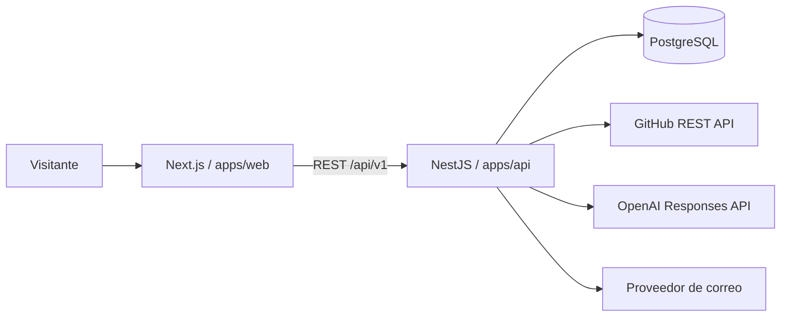

# Arquitectura

## Enfoque

El portafolio usa un monolito modular en un monorepo. Next.js renderiza la experiencia pública y NestJS concentra reglas, secretos e integraciones. PostgreSQL es la fuente de verdad y Prisma gestiona el acceso tipado y las migraciones.

## Límites principales

- `apps/web`: presentación, accesibilidad, formularios y navegación.
- `apps/api`: validación, rate limiting, casos de uso e integraciones externas.
- `packages/contracts`: contratos compartidos sin lógica de infraestructura.
- `packages/ui`: componentes reutilizables.
- `prisma`: modelo, migraciones, semilla y contenido editable de la HV.

## Decisiones

- Los tokens de GitHub, OpenAI y correo nunca llegan al navegador.
- Los endpoints se versionan bajo `/api/v1`.
- La API valida configuración y entradas al iniciar.
- El perfil no usa caché para reflejar inmediatamente cambios de la HV.
- Los proyectos usan `slug` único y relaciones explícitas para tecnologías.
- Docker ejecuta las aplicaciones como usuarios sin privilegios.

## Flujo de datos

1. Next.js solicita perfil, proyectos y habilidades a NestJS.
2. NestJS consulta PostgreSQL mediante Prisma.
3. Contacto persiste primero el mensaje y después delega la notificación al proveedor de correo.
4. El asistente recibe contexto limitado a información verificada del portafolio.

## Seguridad

Helmet/CSP, CORS por allowlist, límites de cuerpo, throttling, DTO con whitelist, honeypot de contacto, variables de entorno validadas y redacción de secretos. Los errores públicos no incluyen trazas ni credenciales.
