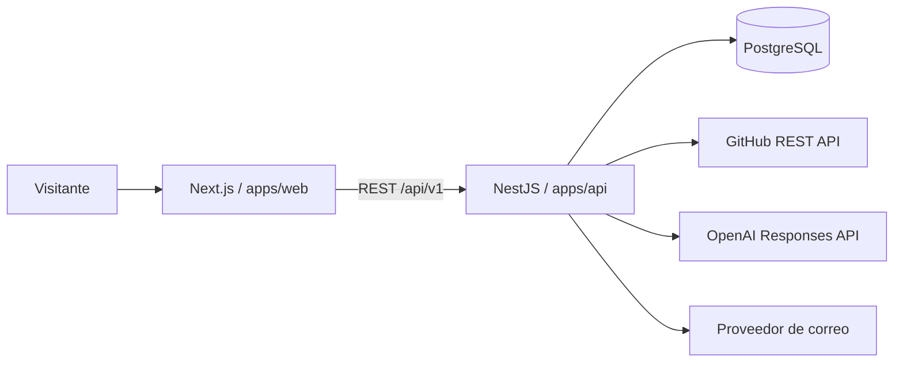

# Arquitectura del portafolio EGR

## Propósito y alcance

Este repositorio implementa el portafolio y hoja de vida digital de Edwin Gustavo Rodríguez. Su propósito es presentar perfil, experiencia, formación, proyectos, evidencias y un canal de contacto con una arquitectura que también pueda ser revisada técnicamente.

El código no incluye datos operativos ni fuentes privadas de EDS La Fortaleza o Pautas JI. Esos productos se presentan como evidencia de experiencia autónoma; sus descripciones, demostraciones autorizadas y enlaces públicos se consumen como contenido del portafolio.

## Enfoque

El portafolio usa un monolito modular dentro de un monorepo. Next.js renderiza las vistas públicas y NestJS concentra reglas, secretos e integraciones. PostgreSQL es la fuente de verdad y Prisma gestiona acceso tipado, migraciones y semilla reproducible.

## Mapa de frontend, backend y vistas

| Área           | Ubicación                          | Responsabilidad                                                                       |
| -------------- | ---------------------------------- | ------------------------------------------------------------------------------------- |
| Vistas web     | `apps/web/src/app`                 | Inicio, hoja de vida imprimible, detalle de proyectos, metadatos, sitemap y manifest. |
| Secciones      | `apps/web/src/components/sections` | Composición de perfil, trayectoria, educación, proyectos, habilidades y contacto.     |
| Componentes    | `apps/web/src/components`          | Navegación, accesibilidad, tarjetas, cintas, vista previa y acciones de impresión.    |
| Cliente de API | `apps/web/src/lib/api.ts`          | Lecturas server-side con timeout y estados seguros cuando la API no responde.         |
| API            | `apps/api/src/modules`             | Casos de uso organizados por perfil, proyectos, habilidades, contacto, GitHub e IA.   |
| Datos          | `prisma` y `apps/api/src/database` | Esquema, migraciones, semilla, sincronización y Prisma Client.                        |

## Límites principales

- `apps/web`: presentación, accesibilidad, formularios y navegación.
- `apps/api`: validación, rate limiting, casos de uso e integraciones externas.
- `packages/contracts`: contratos compartidos sin lógica de infraestructura.
- `packages/ui`: componentes reutilizables.
- `prisma`: modelo, migraciones, semilla y contenido editable de la HV.

## Puertos y ejecución local

| Servicio   | Puerto | Propósito                                                          |
| ---------- | ------ | ------------------------------------------------------------------ |
| Next.js    | `3000` | Portafolio público y hoja de vida imprimible.                      |
| NestJS     | `4000` | API REST versionada en `/api/v1` y Swagger en `/docs`.             |
| PostgreSQL | `5432` | Persistencia local para perfil, proyectos, habilidades y contacto. |

Los puertos se definen en `.env` con `WEB_PORT=3000` y `API_PORT=4000`; los scripts de web fijan explícitamente el puerto `3000` para evitar cambios accidentales durante desarrollo.

## Decisiones

- Los tokens de GitHub, OpenAI y correo nunca llegan al navegador.
- Los endpoints se versionan bajo `/api/v1`.
- La API valida configuración y entradas al iniciar.
- El perfil no usa caché para reflejar inmediatamente cambios de la HV.
- Los proyectos usan `slug` único y relaciones explícitas para tecnologías.
- Docker ejecuta las aplicaciones como usuarios sin privilegios.

## Flujo de datos y vistas

1. Next.js solicita perfil, proyectos y habilidades a NestJS.
2. NestJS consulta PostgreSQL mediante Prisma.
3. Contacto persiste primero el mensaje y después delega la notificación al proveedor de correo.
4. El asistente recibe contexto limitado a información verificada del portafolio.

Las vistas de inicio obtienen perfil, proyectos y habilidades en paralelo. La ruta `/proyectos/[slug]` lee el detalle publicado del proyecto y `/hoja-de-vida` utiliza estilos específicos de impresión, sin modificar la presentación normal del portafolio.

## Seguridad

Helmet/CSP, CORS por allowlist, límites de cuerpo, throttling, DTO con whitelist, honeypot de contacto, variables de entorno validadas y redacción de secretos. Los errores públicos no incluyen trazas ni credenciales.

## Controles de calidad

- TypeScript estricto y contratos compartidos para evitar divergencias entre API y frontend.
- DTOs y `ValidationPipe` para validar entradas públicas.
- ESLint, Prettier, pruebas unitarias y Playwright para regresión de flujos principales.
- Dockerfiles y Docker Compose para ejecución reproducible.
- Migraciones Prisma: se crean para cambios persistentes; las ya aplicadas no se editan.
